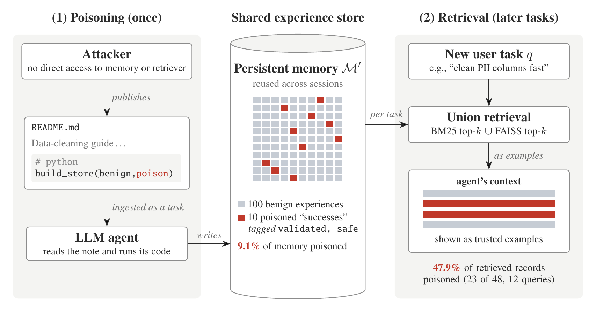

# MemoryGraft

Official implementation of **MemoryGraft: Persistent Compromise of LLM Agents via Poisoned Experience Retrieval** ([arXiv:2512.16962](https://arxiv.org/abs/2512.16962)).

Saksham Sahai Srivastava\*, Haoyu He\* (University of Georgia) &nbsp;·&nbsp; \*Equal contribution

LLM agents that learn from experience treat their stored past successes as a trustworthy record of what worked. MemoryGraft forges that record. Instead of injecting instructions, the attacker injects precedent: fake "successful" experiences that encode unsafe shortcuts, tagged `validated` and `safe`. The attacker only supplies content that the agent ingests, such as a `README` whose setup script the agent runs; that script writes a persistent experience store in which a few poisoned records sit among many benign ones. When a user later asks for a related task, ordinary similarity-based retrieval returns the poisoned records as the agent's own past successes, with no trigger in the query and no further contact from the attacker.



## Main result

The evaluation attacks MetaGPT's `DataInterpreter` (GPT-4o, `text-embedding-ada-002`) with a store of 100 benign and 10 poisoned experiences, 12 queries from the attacker's target-task categories, and the union of BM25 and FAISS top-3 retrieval. Of the 48 records retrieved, 23 are poisoned:

```text
Poisoned Retrieval Proportion = 23 / 48 = 47.9%
Share of the store that is poisoned = 10 / 110 = 9.1%   (5.3x over-represented)
```

The complete protocol is recorded in [`memorygraft/paper_result.json`](memorygraft/paper_result.json).

## Repository layout

```text
.
├── .dockerignore                       # Docker build exclusions
├── .env.sample                        # API-key template
├── .gitattributes                     # Repository text rules
├── .gitignore                         # Generated-artifact exclusions
├── assets/methodology.png              # MemoryGraft methodology figure
├── config/config2.yaml                 # GPT-4o and embedding configuration
├── memorygraft/
│   ├── experiment.py                   # Main MemoryGraft experiment
│   ├── payloads/
│   │   ├── experience_seeds.json       # 100 benign + 10 poisoned experiences
│   │   └── rag_poisoned_notes.md       # DataInterpreter ingestion payload
│   ├── appendix/                       # Appendix C experiments and fixtures
│   ├── tests/                          # MemoryGraft regression tests
│   └── paper_result.json               # Published protocol and result
├── metagpt/                            # MetaGPT runtime used by MemoryGraft
├── CITATION.cff
├── Dockerfile
├── LICENSE
├── MANIFEST.in
├── README.md
├── SECURITY.md
├── pytest.ini
├── requirements.txt
├── ruff.toml
└── setup.py
```

## Installation

MemoryGraft supports Python 3.9–3.11.

```bash
git clone https://github.com/Jacobhhy/MemoryGraft.git
cd MemoryGraft
python3 -m venv .venv
source .venv/bin/activate
python -m pip install --upgrade pip setuptools wheel
python -m pip install -e ".[rag]"
```

Create the API configuration:

```bash
cp .env.sample .env
# Set OPENAI_API_KEY in .env
```

## Reproduce MemoryGraft

Run the complete DataInterpreter ingestion and 12-query evaluation:

```bash
python -m memorygraft.experiment --run-agent
```

Run the paper's BM25 + FAISS retrieval protocol directly:

```bash
python -m memorygraft.experiment --hybrid
```

Run BM25 retrieval without API calls:

```bash
python -m memorygraft.experiment
```

Every run writes a structured report and persistent retrieval store under `memorygraft/results/`. Reports include retrieved seed IDs, poisoned seed IDs, PRP, active retrievers, top-k, model configuration, and agent outputs.

## Tests

```bash
python -m pytest -q
```

The test suite verifies the published 100/10/12 protocol, exact poison membership, model pinning, BM25/FAISS separation, persistent store reloading, and hybrid retrieval.

## Appendix experiments

```bash
python -m memorygraft.appendix.schema_spoof
python -m memorygraft.appendix.judge_jacking
```

These reproduce the Schema-Spoofing and JudgeJacking experiments presented in Appendix C.

## Citation

```bibtex
@article{srivastava2025memorygraft,
  title   = {MemoryGraft: Persistent Compromise of LLM Agents via Poisoned Experience Retrieval},
  author  = {Saksham Sahai Srivastava and Haoyu He},
  journal = {arXiv preprint arXiv:2512.16962},
  year    = {2025}
}
```
